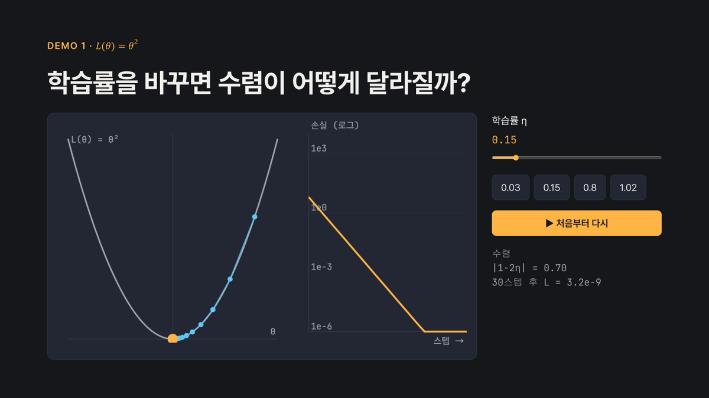
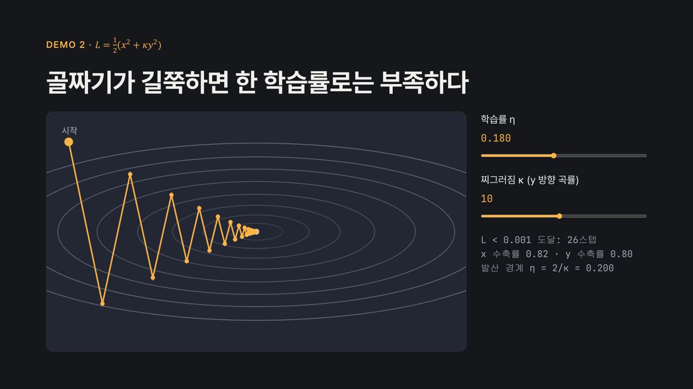
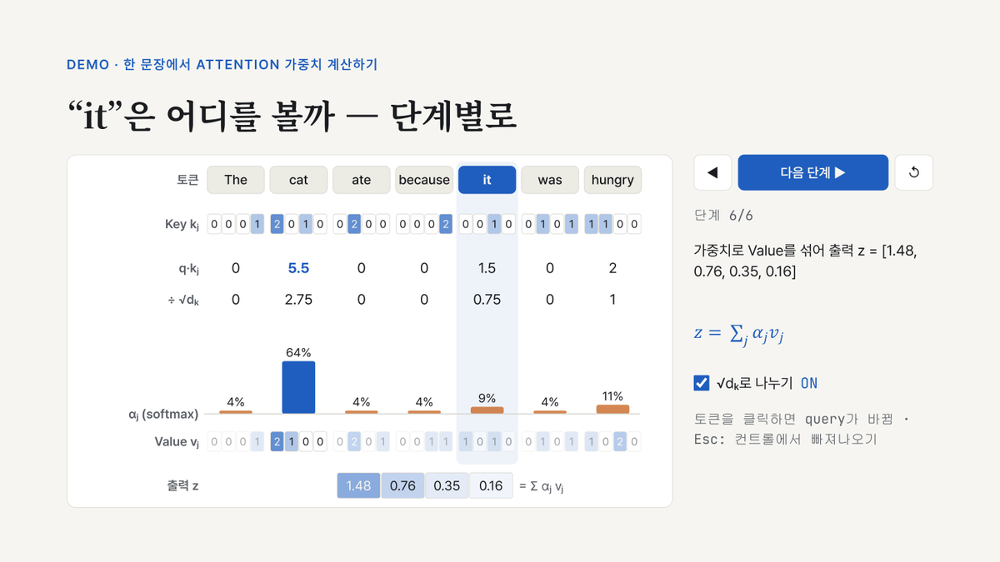

# interactive-slides — Claude Code skill

Single-file HTML presentation decks with **live interactive demos**, KaTeX math, Korean typography,
speaker notes / presenter view, and an automatic layout check — built by Claude Code.

인터랙티브 데모가 들어간 HTML 발표자료를 Claude Code로 만드는 스킬입니다. 슬라이더를 움직이면 그래프가
다시 그려지고, 버튼을 누르면 알고리즘이 한 단계씩 진행되는 슬라이드를 HTML 파일 하나로 만듭니다.



## 무엇이 들어 있나

- **덱 런타임** (`assets/deck-template.html`)
  - 1920×1080 고정 화면을 창 크기에 맞춰 확대·축소
  - 넘기기: →/Space/PageDown, 숫자+Enter로 이동, 단계별로 나타나기(`.step`)
  - 발표자 화면(S): 노트·타이머·다음 슬라이드
  - 블랙아웃(B), 인쇄 시 한 장에 한 슬라이드
- **데모 API** `Deck.demo('#id', { mount, enter, leave })`
  - 슬라이드가 보일 때만 애니메이션 실행
  - 데모 오류는 빨간 배지로 표시하고 넘기기는 계속 동작
  - 슬라이더에 포커스가 있어도 PageUp/PageDown(프레젠터 리모컨)은 항상 슬라이드를 넘김
- **레퍼런스**
  - `demos.md`: 데모 패턴 6종
  - `design.md`: 학술용·강의용 프리셋, 한글 타이포그래피
  - `math-code.md`: 수식, 코드
  - `delivery.md`: 검증, PDF, 공유
- **검사 스크립트** (`scripts/check_deck.js`): 브라우저에서 모든 슬라이드를 돌며 다음을 찾아냄
  - 화면 밖으로 넘친 요소, 22px 미만 글씨, 잘린 상자
  - 키보드로 끝까지 넘어가지 않는 문제, 데모 오류, 버전이 고정되지 않은 CDN 주소

| | |
|---|---|
|  |  |

## 설치

[Claude Code](https://claude.com/claude-code)가 필요합니다.

```bash
git clone https://github.com/YGJangontact/interactive-slides-skill.git
cp -r interactive-slides-skill/skills/interactive-slides ~/.claude/skills/
```

Windows PowerShell:

```powershell
git clone https://github.com/YGJangontact/interactive-slides-skill.git
Copy-Item -Recurse interactive-slides-skill\skills\interactive-slides $HOME\.claude\skills\
```

새 세션부터 스킬 목록에 `interactive-slides`가 나타납니다.

## 사용 예

```
다음주 랩미팅에서 attention 리뷰 10분 발표해. scaled dot-product attention 수식 넣고,
토큰별 attention 가중치가 계산되는 과정을 단계별로 보여주는 데모 하나 넣어서 HTML 슬라이드로 만들어줘.
```

스킬은 다음 순서로 진행합니다.

1. 목적·분량·밀도 확인
2. 구성안 작성: 어느 슬라이드에 어떤 데모를 넣을지 정하고 확인받음
3. 템플릿으로 덱 작성
4. 브라우저에서 `check_deck.js`로 검증
5. 파일 전달, 원하면 PDF나 claude.ai 아티팩트 링크로 공유

`examples/`에 이렇게 만든 덱 두 개가 있습니다. 브라우저로 바로 열어 볼 수 있습니다.

- `examples/gradient-descent/deck.html`: 학습률 슬라이더 데모, 2D 골짜기 데모
- `examples/attention-review/deck.html`: attention 가중치 단계별 계산 데모

## 발표할 때 키

| 키 | 동작 |
|---|---|
| → ↓ Space PageDown | 다음 (단계 → 슬라이드) |
| ← ↑ PageUp | 이전 |
| 숫자 + Enter | 해당 슬라이드로 |
| F | 전체화면 |
| S | 발표자 화면 |
| B | 블랙아웃 |
| Esc | 데모 컨트롤에서 빠져나와 다시 넘기기 |

## PDF

Windows에서는 Edge 헤드리스로 별도 설치 없이 뽑을 수 있습니다(`references/delivery.md` 참고). PDF에는
데모의 초기 상태가 들어가고, 단계별로 나타나는 내용은 모두 펼쳐져 나옵니다.

## 테스트 결과 (2026-10-19, 요청 2개 × 스킬 사용/미사용)

| | 스킬 사용 | 스킬 미사용 |
|---|---|---|
| 자동 검사 통과율 (10~11개 항목) | 100% | 90% |
| 발표자 노트 | 2/2 | 1/2 |
| 인쇄(PDF) CSS | 2/2 | 1/2 |
| 발표자 화면 | 2/2 | 0/2 |
| 평균 토큰 | ~124k | ~94k |

스킬 없이도 Claude는 동작하는 HTML 덱을 잘 만듭니다. 스킬이 보장해 주는 것은 발표 도구 쪽(노트, 발표자
화면, PDF, 검사)이 매번 빠지지 않는다는 점입니다. 대신 토큰을 약 30% 더 씁니다.

## 알려진 제한

- 폰트(Google Fonts)와 KaTeX는 CDN에서 불러옵니다. 오프라인이면 시스템 폰트로 대체되고 수식은 TeX 원문으로 보입니다.
- 발표자 화면은 같은 파일을 새 창과 iframe으로 엽니다. `file://`에서 빈 화면이면 `python -m http.server`로 열어 주세요.
- 헤드리스 Chrome/Edge의 `--screenshot`은 문장 속 MathML을 그리지 않습니다. 이미지는 PDF를 거쳐 만드세요.

## Credits

The fixed-stage and navigation core is adapted from
[frontend-slides](https://github.com/zarazhangrui/frontend-slides) by Zara Zhang (MIT);
see `skills/interactive-slides/NOTICE-frontend-slides.txt`.

## License

MIT © 2026 YGJangontact
